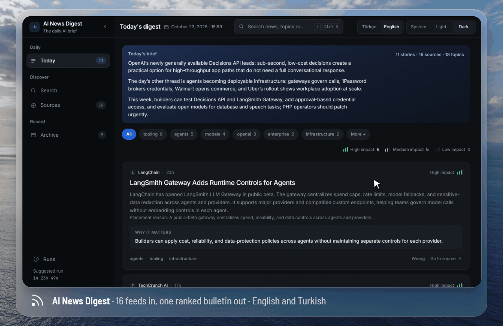
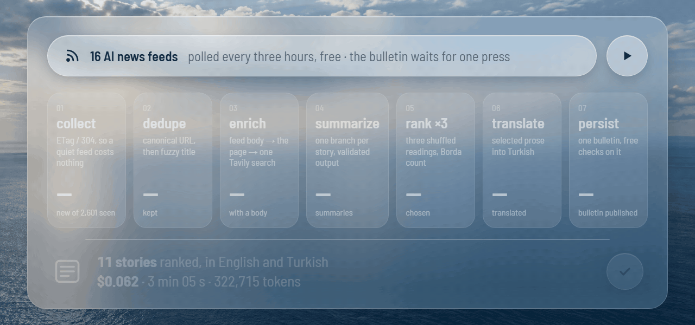
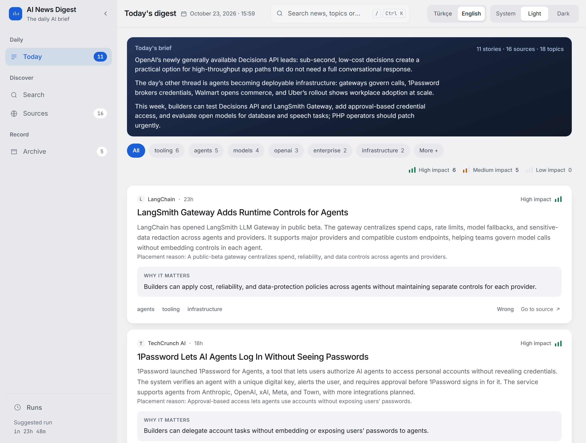
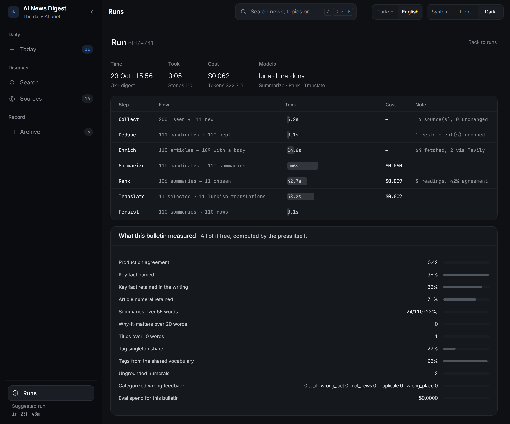

<div align="center">

# AI News Digest

**The day's AI news from sixteen feeds, deduplicated, summarised and ranked into one bulletin you read in English or Turkish.**

[](https://github.com/brkakyldz/ai-news-digest/actions/workflows/ci.yml)


[](LICENSE)



</div>

## What it does

- **Watches sixteen AI news feeds** (OpenAI, DeepMind, Hugging Face, The Verge, TechCrunch, Simon Willison and more) and polls them every three hours. Polling is free, because a feed that has not changed answers `304`.
- **Writes the day's bulletin when you press Run.** It drops the same launch reported by five outlets, summarises each remaining story, ranks the whole day three times and publishes the stories the readings put on top.
- **Publishes every bulletin in English and Turkish.** It shows the same stories in the same order, and one switch flips both the prose and the interface.
- **Shows its work.** Every run records each step's time, tokens and cost, and runs free quality checks on what it just published.

Everything runs on one machine: a single container with a SQLite file, and no cloud services except the model API.

## Try it in one command

```bash
docker compose -f docker-compose.demo.yml up --build
```

Open <http://localhost:8000>. The demo ships three real recorded days, so it needs no API key and spends nothing. The recording keeps headlines, links and the model's writing, but not the articles themselves, which belong to their publishers.

**With your own key.** You need Docker and an `OPENAI_API_KEY`. Tavily is optional: without it, the third enrichment step is skipped.

```bash
cp env.example.template .env    # add your OPENAI_API_KEY
docker compose up --build
```

Open **Runs** and press **Run now**. The confirmation shows how many stories are waiting and which models will be used before anything is spent.

## How a bulletin is made



| Step | What it does |
|---|---|
| **collect** | Polls every enabled feed with its stored `ETag`, so an unchanged feed costs one `304`. |
| **dedupe** | Matches canonical URLs for syndicated copies, then fuzzy-matches titles for independent write-ups of the same story. |
| **enrich** | Gives thin items a body using the cheapest source that works: the feed's own HTML, then the page, then one capped Tavily search. |
| **summarize** | Fans out one LangGraph `Send` branch per story. Each branch returns a validated Pydantic model and saves its own row. |
| **rank ×3** | Reads the whole day three times, shuffled, and merges the readings by Borda count. Their agreement is stored with the bulletin. |
| **translate** | Writes Turkish versions of the selected stories and the editor's note, reusing any translation already made. |
| **persist** | Publishes the bulletin, runs the free quality checks on it and closes the run with its tokens and cost. |

The feed poll is the only thing that runs on a schedule. A bulletin costs money, so it waits for a person to press Run.

A second press on the same day summarises only what has arrived since, re-ranks the whole day and publishes version 2 of the same bulletin. If a press fails half-way, the summaries it already paid for are kept, and the next press starts from them.

This is a fixed LangGraph pipeline, not a tool-calling agent: no model decides which step runs next. [`docs/HOW-IT-WORKS.md`](docs/HOW-IT-WORKS.md) walks through the whole path, from a feed being polled to a story being read.

## Screens

<table>
<tr>
<td width="50%"></td>
<td width="50%"></td>
</tr>
<tr>
<td><b>The bulletin.</b> Headline size follows importance. Every story says why it matters and links to its source.</td>
<td><b>One run.</b> Time, tokens and cost per step, and the checks run on what it published.</td>
</tr>
</table>

## What it costs

The press in the animation above ran on 2026-10-23 with `gpt-6-luna` on every paid step:

| New stories summarised | Ranked (×3) | Published and translated | Tokens | Cost | Time |
|---|---|---|---|---|---|
| 110 | 106 | 11 | 322,715 | **$0.062** | 3 min 05 s |

That run was priced at $0.10 per million input tokens and $0.50 per million output tokens ([OpenAI pricing](https://developers.openai.com/api/docs/pricing), checked 2026-10-23). Reading, searching and feed polling cost nothing. Each press has an estimated ceiling, $1 by default, and Tavily has its own daily credit cap.

## Is it any good?

Each press runs free checks on what it published and stores the results. They show whether the key fact survived the summary, whether every number in a summary appears in its article, whether word budgets were kept, how useful the tags are, and how much the three rankings agreed.

On any story you can press **Wrong** and say which claim failed: the fact, whether it is news at all, a duplicate, or its placement. The checks that cost money are explicit CLI commands with a cost cap: a sampled grounding judge, and a comparison of two prompts over the same frozen articles. Nothing in the app starts them. [`docs/EVALUATING.md`](docs/EVALUATING.md) explains each number and when to trust it.

## Without Docker

```bash
uv sync
uv run ainews digest      # one full press
uv run ainews serve       # the dashboard on :8000
```

To serve the demo instead, set `DEMO_MODE=true` in `.env` before the first `serve` on an empty database. The CLI calls the same functions as the dashboard:

```bash
uv run ainews collect     # poll the feeds; no model, no cost
uv run ainews sources     # what is polled and what each feed last said
uv run ainews eval judge --bulletin latest   # paid, estimated and capped first
```

## Stack

LangGraph `StateGraph` · `gpt-6-luna` via `langchain-openai` · feedparser and Tavily · SQLite (WAL, FTS5) with SQLAlchemy 2 and Alembic · FastAPI, Jinja and HTMX · APScheduler, in-process.

```
src/ainews/
  sources/    feed polling and enrichment
  pipeline/   the LangGraph graph and its seven nodes
  quality/    free checks, run at every press
  evals/      paid evaluations, imported only by the CLI
  web/        the dashboard
  demo/       the recorded days the demo serves
```

## Development

```bash
uv sync
uv run pytest          # offline: a fake model, recorded HTTP, no key needed
uv run ruff check .
```

MIT licensed — see [`LICENSE`](LICENSE).
