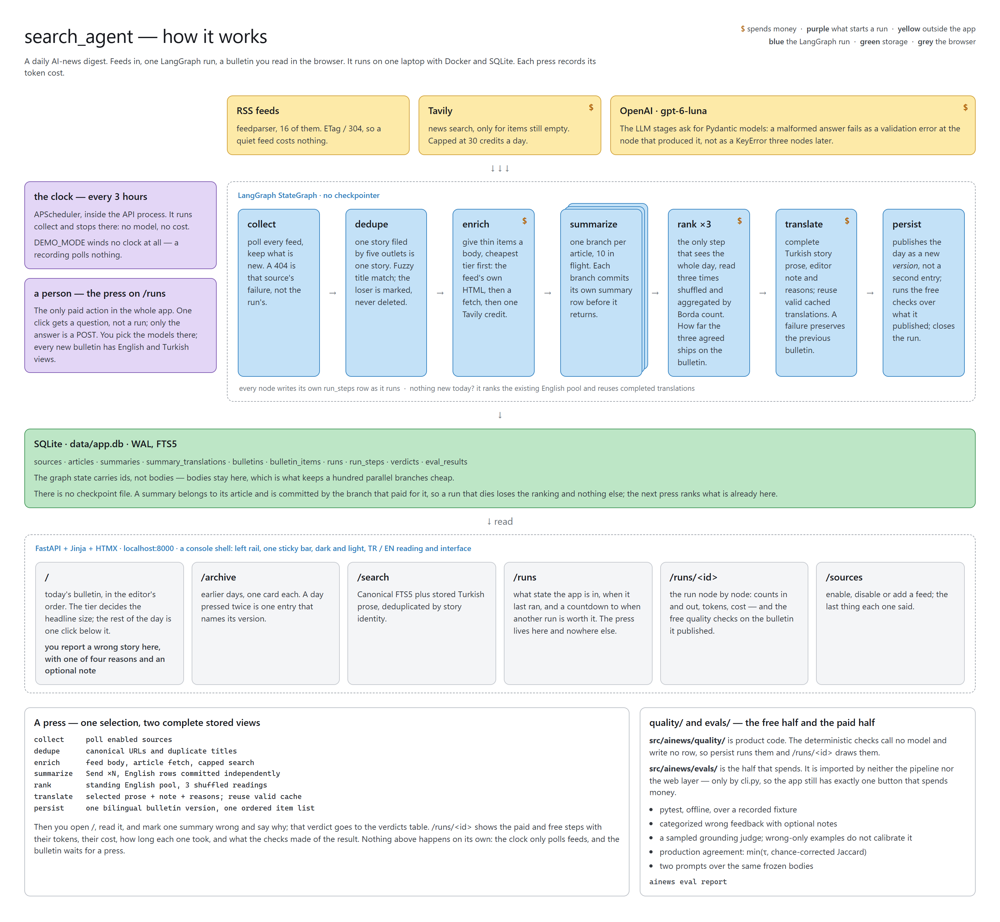
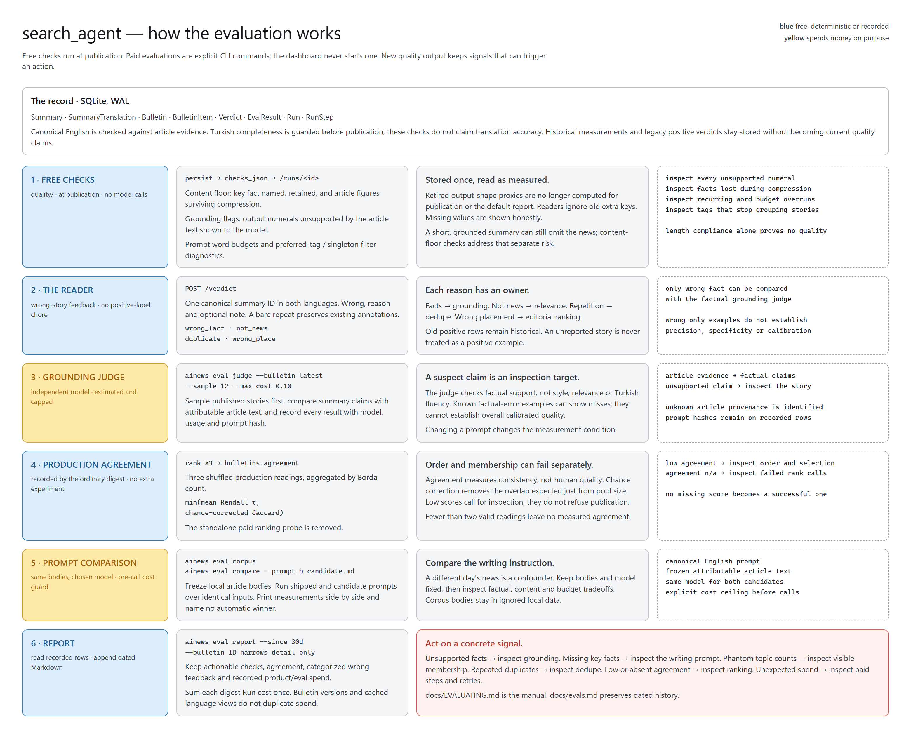

# How it works

Everything about this project in one file: what it believes, how it is built,
what happens between a feed being polled and a story being read, and how it
knows whether any of it is any good.

It is a narrative, not a reference. Every value it mentions lives in the code,
and the code is the authority — where this document and a line of Python
disagree, the Python is right and this file is stale. Line references are given
as `file.py` so you can go and check.

**Part I — the idea** is the philosophy: what the thing is for, and the handful
of beliefs every decision below falls out of. **Part II — the machine** is the
walkthrough. **Part III — whether it is any good** is testing and evaluation.
**Part IV — the record** is the choice list and what is deliberately missing.

The code cites those choices by number — a comment reading `(ADR 0007)` points
at line 0007 of the table in §17.

---

# Part I — The idea

## 1. What the thing is

One process. It polls sixteen RSS feeds, throws away the same story told five
times, summarises what is left with an LLM, ranks the whole day three times over
and publishes what the three readings agree on, and serves the result as one
page with complete English and Turkish views. It runs on one machine, in one
container; the recorded per-run bill is visible alongside the work.

There is exactly one thing on a clock: the feed poll, every three hours, which
costs nothing. The digest — the part that spends money — is started by a person
pressing a button (ADR 0015). The page's job is to tell them when that is worth
doing.



```
                 ┌──────────── FastAPI, one uvicorn worker ─────────────┐
                 │  APScheduler: collect */3h — nothing else on a clock │
                 │  POST /runs/start  ← the button a person presses     │
                 └───────────────────────┬─────────────────────────────-┘
                                         │  run_digest(models) → English + Turkish
                                         ▼
  RSS feeds ─► collect ─► dedupe ─► enrich ─► summarize ─► rank ×3 ─► translate ─► persist
                                         │                    │                     │
                                         │              a summary per          a bulletin
                                         │               article, now            per day
                                         ▼
    SQLite: sources · articles · summaries · summary_translations · bulletins · bulletin_items
                         runs · run_steps · verdicts · eval_results
                                         │
                                         ▼
          Jinja + HTMX:  /   /archive   /sources   /runs   /runs/<id>   /runs/verdicts   /search
```

## 2. The seven beliefs

Nothing in Part II is arbitrary. Each of these produced decisions that show up
in the code, and each one is stated here so a later change can be checked against
it rather than against taste.

### 2.1 It is an instrument, not a product

It is opened once in the morning, read for a few minutes, and closed. Nobody has
to be persuaded of anything, so there is no hero, no atmosphere, no scroll
animation and no marketing surface anywhere in it. The method behind the page is
one question asked of every element — *what is your job, and does the content
already do it?* — and the list of things deleted by that question is longer than
the list of things that survived it.

The strongest form of this is the ranking. A digest normally puts a number or a
badge beside each story; here the headline's size and ink step come from the
importance score, so the page dims from top to bottom and the reader learns where
to stop from the shape of it. An order is already an order — the numbers 01–15
were deleted for saying it twice.

### 2.2 Money is a design material, not an implementation detail

The budget is under $10 a month. Each run records its paid usage so the operator
can compare actual presses with that budget. The constraint shapes the architecture:

- Enrichment is **three tiers, cheapest first**, and the paid tier only runs for
  an item that is still empty after the two free ones.
- The Tavily credit cap is a **database table**, not a counter in memory, because
  a process that restarts twice a day would otherwise reset its own budget twice
  a day.
- Ranking reads **the whole day in one prompt**, three times over, rather than
  comparing stories pair by pair: the price of a second and third reading is two
  more prompts, not a quadratic number of them.
- The price per million tokens is drawn **under the button, before the press**,
  because the tiers differ by up to fifty times and a surprise belongs on screen
  rather than in a billing dashboard next month (ADR 0020).
- The digest is **not on a clock at all** (ADR 0015). The one thing that runs
  unattended is the thing that is free.

What the constraint did *not* buy is a cheap pre-filter. Every collected article
is summarised: a title-only filter deciding in advance what deserves reading can
hide the story the day was actually about (ADR 0001). Current summary, ranking
and translation costs are recorded per run rather than inferred from the old
single-language unit estimate.

### 2.3 Contain failures at the right boundary

A digest is many small jobs. Most failures are contained at a single source or
article, while required translation completeness is a publication boundary:

| The unit | What its failure costs |
|---|---|
| One feed | That source's row is marked; the other fifteen are polled |
| One article's summarize call | An entry in `errors`; ninety-nine summaries still ship |
| The rank call | Fallback ordering by importance, then source weight; the editor's note says so |
| Tavily | An empty string and a thinner summary |
| The WAL pragma | A warning, and the rollback journal |
| Bookkeeping (`run_steps`, tracing) | Swallowed and logged — a paid run is never killed by its own instrumentation |
| Required Turkish prose | Hard error before publication; previous bulletin stays readable and completed translations remain reusable |

`partial` is a real run status and not a soft failure: three articles would not
summarise and the other ninety-seven are still a bulletin. It means that and
only that. A feed that 404ed is recorded on the collect step's row and does not
reach the run's status — when it did, one rotting mirror marked every bulletin
degraded until the source auto-disabled, and the word stopped carrying
information.

### 2.4 The machine has to be able to explain itself

The `runs` row always said what a run cost. It never said *where* that went, so
the two questions a person actually asks of a slow or expensive run — which node
ate the two minutes, which node ate the eleven cents — had no answer short of
reading the log. `run_steps` answers both, one row per node, and `/runs/<id>`
reads it back (ADR 0022).

The same belief is why a duplicate article is **marked and never deleted** — a
wrong merge stays inspectable instead of becoming an article nobody can explain
the absence of — and why a run that crashed is closed as `error` rather than left
saying `running` forever.

### 2.5 Inspect concrete errors

Free content, numeral, budget and tag checks run on each publication. Production
ranking stores its own agreement. A reader can report a wrong fact, irrelevant
story, duplicate or wrong placement, with an optional note. A sampled grounding
judge and frozen-corpus prompt comparisons remain explicit paid CLI operations.
Wrong-only feedback cannot establish judge precision or specificity, and the
report makes no calibrated-quality claim.

The free half is product code in `ainews/quality/`; the pipeline and web never
import paid `ainews/evals/` code. The operational interpretation of each retained
signal lives in [EVALUATING.md](EVALUATING.md).

### 2.6 Show, do not spend

The app is cloned and run by one person and never deployed. That frame decides
what belongs in the interface: the interface may **show** anything — what a run
cost, which model wrote it, how long each node took, how many summaries carry a
verdict — and it has exactly **one control that spends money**, which is the
press on `/runs`.

That is why the evaluation, which is genuinely interesting to look at, is a
terminal command and not a second button (ADR 0023). A second paid press would
have doubled the ways to be surprised by a bill in exchange for saving one
`uv run`.

### 2.7 A value lives in one place, and a decision lives next to what it changed

Colours and scale live in `theme.css` and are never restated in a document. A
read query lives in `web/queries.py` and never in a route, because all the pages
want the same few shapes and a query written twice is a query that disagrees with
itself later. Model names live in `pipeline/pricing.py`, which is the price table
and the menu at once. The environment is read in exactly one module, `config.py`.

And the reason for a line is a comment *on* that line, not a paragraph collected
into a design document somewhere else. This file carries the shape of the system;
the code carries why each piece of it is the way it is.

## 3. Reading the code

Four conventions, worth knowing before opening a file.

| | |
|---|---|
| **Comments explain the failing case, not the syntax** | A comment here usually describes what went wrong without the line, with the scenario spelled out. They are long on purpose: the trap is the thing worth writing down, and a reader who already knows the trap can skip a paragraph faster than they can rediscover it. |
| **Choices are cited by number** | `(ADR 0007)` in a comment means row 0007 of the table in §17. Later rows revise earlier ones where they conflict, and the table says which. |
| **Tests are named as claims** | `test_a_failing_search_still_costs_its_credit`, not `test_tavily_error`. The suite reads as a list of things the system promises — §14. |
| **English in the repo, both languages on screen** | Code, comments and documents are English. The interface speaks Turkish and English, and every visible string lives in `web/i18n.py` in two dictionaries so the two can be diffed against each other — a missing key is a `KeyError` at render, not a silent English fallback. |

---

# Part II — The machine

## 4. The layers, and what each one is not allowed to do

| Layer | Files | Rule it lives by |
|---|---|---|
| Configuration | `src/ainews/config.py` | The only module that reads the environment. Nothing else touches `os.environ`. |
| Sources | `src/ainews/sources/` | Talks to the outside world: HTTP, feed parsing, extraction, Tavily. Knows nothing about the graph. |
| Persistence | `src/ainews/db/` | Eleven tables plus an FTS5 index. Owns the connection pragmas. |
| Pipeline | `src/ainews/pipeline/` | The LangGraph nodes, the two entry points that open and close a run row, the price table, and the step recorder. `pipeline/api.py` is the only part of it the web layer may name. |
| Scheduling | `src/ainews/scheduler.py` | One interval job, in-process. |
| Web | `src/ainews/web/` | Routes, read queries, the shell's context, templates. Never writes a summary. `format.py` is pure formatting; `views.py` is what touches a session or a request; `queries.py` is SQL. |
| CLI | `src/ainews/cli.py` | Calls the same functions the button and the poll call. No second implementation. |
| Quality | `src/ainews/quality/` | The deterministic checks and the query that shapes a day's stories for them. Calls no model, spends nothing, writes no row — so the pipeline may import it, and does. |
| Evaluation | `src/ainews/evals/` | Reads the database, `quality/` and the pipeline's node functions; imported by neither the pipeline nor the web layer. Spends money only behind `ainews eval judge` / `compare`, never in `pytest`. |
| Demo | `src/ainews/demo/` | One recorded day as JSON, and the export and seed either side of it. Imported by the CLI and by the web layer's startup, and only when `DEMO_MODE` is on. |

The dependency direction is one-way: web and CLI both call into pipeline,
pipeline calls into sources and db, and nothing calls back up.
`pipeline/nodes/summarize.py` never imports anything from `web/`, which is why
the CLI can run a digest with no HTTP server anywhere in the process.

Inside the web layer the direction is one-way too, and it takes three modules to
hold it. `queries` needs an age string and a local date; `views` needs the
shell's counts; two modules importing each other from inside four function
bodies is a cycle with the admission left out. There is no cycle to admit — the
half `queries` needs is a pure function of its arguments. That half is
`format.py`, `views.py` keeps what touches a session or a request, and both
import downward only.

The web layer's three reach-ins past the pipeline's front door — a route
importing a collect node, a query importing a dedupe node, the advice block
importing the runner — go through `pipeline/api.py`, which names the three
questions the web layer may ask and starts no work by asking them. The
function-level imports that remain are the CLI deferring a 1.3-second
`langchain` import it does not need, plus one seam in `routes/runs.py` that a
test patches through.

## 5. Configuration

`Settings` (`src/ainews/config.py`) is a `pydantic-settings` model read from
the dotenv file once and cached with `lru_cache`. Every knob an operator is meant
to touch is a field on it, and every field has a bound where a bound is
meaningful — `digest_top_n` is `ge=1, le=100`, `dedupe_score_threshold` is
`0..100`. A typo in the environment fails at startup with a validation error
naming the field, rather than at 03:00 as a division by zero.

Two details worth naming:

- **`_blank_placeholders`** (`config.py`). The shipped template contains
  `sk-proj-xxxx…`. A key that still holds `xxxx` is treated as unset, so a fresh
  clone that copied the template but never edited it reports "no key" instead of
  authenticating with a placeholder and getting a 401 four nodes deep.
- **`sqlite_path`** (`config.py`). Derives the filesystem path from
  `DATABASE_URL`, which is what WAL setup, the health probe and the CLI's
  "database ready at …" line all print.

- **`demo_mode`** (`config.py`). One boolean that changes what starting the
  application means: it seeds the recorded day into an empty database, draws a
  band naming the day that press really ran, and winds no clock. It is off by
  default and nothing else in the codebase branches on it (§11.1).

The three `OPENAI_MODEL*` fields are **defaults, not settings** (ADR 0020):
which model runs is an argument to the work, chosen in the confirmation on
`/runs` or with the CLI's `--model-*` flags, and these say what a press that
names nothing falls back to. `openai_model_summarize` is its own knob for the
reason ADR 0001 gives: summary and translation quality can move up a tier while
ranking remains independently selectable. The selected summary model also
translates Turkish prose, so changing it affects both stages' cost and quality.

## 6. The data model

Eleven real tables in `src/ainews/db/models.py`, plus a virtual one.

Every timestamp column is `UTCDateTime`, a `TypeDecorator` rather than
`DateTime(timezone=True)`. The difference matters because SQLite has no timestamp
type: it stores a string, so `timezone=True` was a promise the backend could not
keep and every value read back was naive. Three readers re-attached UTC by hand
and agreed by luck; `steps._fan_out_row` mixed a naive column with an aware
`utcnow()` and raised on the one path where it mattered most. The conversion is
at the boundary now, both ways — normalised to UTC going in, aware coming out —
and nothing above the model has to think about it.

**`sources`** (`models.py`) — what to poll. Beyond name and URL it carries
`etag` and `modified`, the conditional-GET tokens from the last successful fetch;
`consecutive_failures`, which is what auto-disables a rotted feed; and `weight`
(0.5–2.0), an editorial figure that does two jobs — it breaks ranking ties and it
decides which thin articles are worth a Tavily credit.

**`articles`** (`models.py`) — one item from one feed. `url_canonical` is
`unique`, and that uniqueness *is* the first layer of deduplication. `dup_of` is a
self-referencing FK recording a fuzzy-duplicate decision; a duplicate is marked,
never deleted.

**`runs`** (`models.py`) — one execution, which is to say one press. The id is
a uuid hex string. It carries the counts, the token totals, the estimated cost
and the error text; `status` is one of `running | ok | partial | error`, and
`partial` is a finished run with a note rather than a failure, which is why only
`error` is drawn in the alarm colour. What a run does *not* carry is the reading.
A press buys summaries and publishes a bulletin, and both of those outlive it.

**`run_steps`** (`models.py`) — one row per graph node per run: the two
timestamps, the counts in and out, the model, the tokens, the estimated cost, a
status and a note. This is what `/runs/<id>` reads (ADR 0022, and §9 below).

**`summaries`** (`models.py`) — the LLM's read of one article, in one language,
under `UNIQUE(article_id, language)`. A summary belongs to the article and not to
the press that paid for it (ADR 0030), so it is written once — by the fan-out
branch, the moment that branch comes back — and no later run rewrites it.
`importance` is the summariser's own 1–5, check-constrained, and it is the number
the page draws for a story standing *outside* a bulletin. `relevant` is the
summariser's answer to "is this AI news at all", `kind` is what sort of item it
is, and `key_fact` is the one figure, name, version or date that makes the story
news — the field the content check reads (§15).

**`summary_translations`** — reusable Turkish headline, summary and consequence,
keyed on canonical summary ID and language. A hash of the English source prose
validates the cache; model, token counts and cost travel with each translation.
Manual canonical repair invalidates that cache in the same transaction.

**`bulletins`** (`models.py`) — one day's selection with stored language views, under
`UNIQUE(day, language, version)`. `day` is a **local** calendar day, computed in
Python by `ainews/clock.py` and stored as `YYYY-MM-DD`: `date()` in SQLite would
apply the rule in UTC and file a 02:00 Antalya story under the previous day. A
second press the same day publishes `version = 2` over the same window instead of
a second entry, so the archive lists days, and the version it replaced stays as
what the front page said at the time. The row also carries `editor_note`,
`model_rank`, what the press spent, `agreement` — how far the three rank readings
agreed (§7.6) — and `checks_json`, the free quality checks exactly as the press
computed them.

**`bulletin_items`** (`models.py`) — one story's place in one bulletin:
`position`, `tier` (`lead | major | notable | brief`) and `reason`, fifteen words
from the ranker on why this story rather than the three other angles on the same
event. A bulletin reads in `position` order and only `position`. Sorting by tier
would regroup the editor's argument, and a notable sitting between two majors is
a legitimate claim about a day.

**`verdicts`** (`models.py`) — categorized wrong feedback on one summary. New
writes accept only `wrong`; old `ok` rows remain read-only history. The reason is
one of four claims: `wrong_fact |
not_news | duplicate | wrong_place`, plus an optional note. Four words rather
than one because a story block asserts four separate things, and only
`wrong_fact` is evidence about the grounding judge (§15). One row per summary; a
later verdict overwrites the earlier one rather than accumulating a history
nobody reads.

**`eval_results`** (`models.py`) — one measurement that cost money: a judged
summary or a preserved historical rank-probe row, keyed on the **bulletin** it measured, because a
measurement is about what was published rather than about the press that paid for
it. It carries its own tokens and cost, so `ainews eval report` totals evaluation
spend beside product spend, and `prompt_version`, a twelve-character hash of the
prompt file it ran under — so no rate can be quoted under a prompt that has since
been edited.

**`daily_counters`** (`models.py`) — the durable half of the Tavily credit
cap, as described in §2.2.

**`summaries_fts`** — an FTS5 virtual table created in `db/schema.py` with
`content=''` (contentless: the text lives once, in `summaries`, and the index
stores only terms) plus three triggers that keep it in step on insert, delete and
update. `rowid` is the summary id, so a hit joins straight back. This is DDL
SQLAlchemy has no vocabulary for, which is why it is raw SQL, written out in the
baseline revision that creates the tables it indexes.

The schema is an Alembic chain (ADR 0028). `init_db()` (`schema.py`) still runs
at every start and is still idempotent; what it does is upgrade to head. A
database with a version stamp is upgraded, one with our tables and no stamp is
stamped at the baseline and then upgraded — that is the archive built before
migrations existed — and an empty file gets every revision in order. A new
column is a revision, and so is a changed constraint, which SQLite can only do
by rebuilding the table (`render_as_batch`).

### Connection setup

`_apply_pragmas` (`db/session.py`) runs on every new connection: WAL,
`synchronous=NORMAL`, `foreign_keys=ON` (SQLite leaves them off by default) and
`busy_timeout=10000` so the single writer waits rather than raising.

The WAL line is wrapped in its own `try` (`session.py`) and this is not
defensive habit. WAL needs a shared-memory file beside the database, and a Windows
host directory bind-mounted into a Linux container cannot provide one:
`PRAGMA journal_mode=WAL` raises `disk I/O error` and takes the whole application
down at startup with an error message that names nothing useful. Caught, it logs
what actually happened and points at ADR 0007 — and the tool still works, because
without WAL a reading page merely blocks behind a writing digest, which for one
reader is a pause and not a failure. `docker-compose.yml` uses a named volume for
exactly this reason.

## 7. Collection and the digest graph

### 7.1 collect — the cheap half

`collect_articles` (`pipeline/nodes/collect.py`) is the single implementation
of "what does collection mean". It is called from two places: the three-hourly
scheduler job, and the first node of the digest graph.

**Conditional GET.** `fetch_feed` (`sources/rss.py`) sends the stored `ETag`
and `Last-Modified` back as `If-None-Match` / `If-Modified-Since`. feedparser's
own documentation warns that publishers ban clients that re-download an unchanged
feed, and this one polls sixteen of them eight times a day, so a `304`
(`rss.py`) costs nothing and is the normal case. Validators are only
overwritten when the server actually sends them, so a feed that drops its ETag on
one response does not lose ours.

**The User-Agent.** `rss.py` sends a browser string. The Verge and Ars Technica
reject the default Python one outright; that constant is what makes those two
feeds exist for us.

**Failure is per-source, never per-run.** Feeds are fetched concurrently with
`asyncio.gather`; a failure marks its own source and increments
`consecutive_failures`, and at `SOURCE_MAX_FAILURES` the source disables itself
(`collect.py`). That is the only thing standing between a rotted feed and a
warning line every three hours forever.

Two errors are caught that look like they should not need to be: `httpx.InvalidURL`
is *not* an `HTTPError` — httpx raises it while building the request, before any
transport runs, for a stored link like `http://[::1`. Uncaught it escapes the
`gather` and takes the whole run down over one bad row. The same trap is guarded
in `extract.fetch_article`.

**The age horizon.** `_too_old` (`collect.py`) drops entries older than
`COLLECT_MAX_AGE_DAYS` (7). Several feeds serve their entire archive — OpenAI
ships 1169 entries, Hugging Face 859 — and without the horizon the first collect
would summarise years of news at real cost. An item with no date is treated as
current.

**URL canonicalisation.** `canonical_url` (`sources/urls.py`) is the first and
cheapest deduplication layer: `utm_*` and friends stripped, `www.`/`m.`/`amp.`
hostnames folded, scheme normalised to https, trailing slash and fragment
dropped. Only *tracking* parameters are removed, from a denylist — a query string
can be load-bearing (`?p=44001` on WordPress), so an allowlist would silently
merge distinct articles. The function never raises: `urlsplit` parses lazily, so
`javascript:void(0)` — which real feeds do carry — only explodes several lines
later when `.port` tries to cast `void(0)` to an int.

With `url_canonical` unique across the table (`collect.py`), an article
syndicated to three feeds is stored once and attributed to whichever feed reached
us first.

**Seeding.** `sync_sources` (`sources/seed.py`) loads `feeds.yaml` into the
table on every start, and the sync is one-way and additive: a feed in the file
that is missing from the table is inserted, and everything else is left as the
operator left it. A feed disabled in `/sources` therefore stays disabled across
restarts, which it would not if this were an upsert. `BLOCKED_HOSTS`
(`seed.py`) refuses Hacker News and Reddit at the host level, even by hand in
the UI — both are firehoses of "title plus someone else's link", and hnrss.org
alone serves a dozen query variants of one feed.

### 7.2 The graph, and the one interesting edge

`build_graph()` (`pipeline/graph.py`):

```
START → collect → dedupe → enrich → [Send × N] summarize → rank → translate → persist → END
```

Only one edge is interesting, and it is `enrich → summarize`.

**State design.** `PipelineState` (`pipeline/state.py`) carries **ids, not
bodies**. State is copied between supersteps and merged across a hundred parallel
branches; a hundred article bodies in there would turn a cheap run into a slow
one for no gain, since the row is one query away in a database the node is
already talking to. Bodies stay in SQLite and the graph passes primary keys.

**There is no checkpointer** (`graph.py`). A checkpoint is a way of not losing
work when a run dies, and the work here is bought summaries — which are rows,
committed by the branch that paid for them (§7.5). Durability that the archive
already provides is durability worth nothing twice, and replaying a graph from a
checkpoint whose prompts, models and state schema have since moved is a harder
promise than "the next press ranks what is already there".

Two fields are reducer fields — `summaries` and `errors`, both
`Annotated[list[...], operator.add]` (`state.py`). That is the only reason a
hundred parallel branches can write to one key without clobbering each other.

The LLM's output is a **Pydantic model, not a prompt convention**: `ArticleSummary`
and `RankedDigest` are used with `with_structured_output`, so a malformed answer
fails as a validation error at the node that produced it rather than as a
`KeyError` three nodes later.

Every node in `graph.py` is a thin adapter around a function in `nodes/`, and
every adapter is wrapped in `step()` — §9.

### 7.3 dedupe

`dedupe_candidates` (`pipeline/nodes/dedupe.py`) does the half the URL index
cannot: the same story written up separately by five outlets — "OpenAI releases
GPT-5.6 Luna", "OpenAI ships new cheap model", "GPT-5.6 Luna is here" — is three
URLs, three rows and one story.

Titles are normalised first (`normalize_title`): the outlet suffix after a dash or
pipe is stripped, aggregator prefixes (`Show HN:`, `Opinion:`) are removed,
punctuation goes, case folds. The comparison is `rapidfuzz.fuzz.token_set_ratio`
at `DEDUPE_SCORE_THRESHOLD` (85), and `token_set_ratio` specifically, because the
failure mode here is a headline that adds or drops words rather than misspelling
them: token set ignores order and duplication and scores on shared vocabulary,
which is exactly the shape of "OpenAI ships X" versus "X shipped by OpenAI today".

A survivor is appended to the reference set as the loop runs (`dedupe.py`), so
the third outlet covering a story matches the first rather than sliding through
because the second was already marked.

`_unsummarized` (`dedupe.py`) is where the delta lives. A candidate is an
article with no summary in any language in any run, not marked as a duplicate, and
inside the age horizon. That is what makes "run now" idempotent-in-cost: pressing
the button twice in a row summarises nothing the second time, so the page can
advise without ever having to refuse.

Its order is the **survivor rule**: heaviest source first, earliest write-up
second (ADR 0025). The loop keeps the first member of a cluster it meets and marks
the rest as its duplicates, so the order decides which outlet's version is
summarised — and newest-first decides it wrongly. OpenAI posts at 09:00 at weight
2.0 and TechCrunch rewrites it at 11:00 at weight 1.0; on a newest-first pass the
rewrite survives and the lab's own post is marked `dup_of` it. The rank prompt's rule that the representative of
an event is the primary source's item then had nothing to apply to — the primary
source never reached the ranker.

### 7.4 enrich

`enrich_articles` (`pipeline/nodes/enrich.py`) gives thin articles a body, in
three tiers, cheapest first, each running only when the one before came back
short:

1. **Clean the HTML the feed already sent.** Free. Covers most feeds.
   `clean_html` (`sources/extract.py`) runs trafilatura and falls back to a
   naive tag-strip, because on a two-sentence teaser trafilatura sometimes decides
   there is no article at all and returns nothing — and a teaser is better than an
   empty body.
2. **Fetch the page and extract it.** Costs a request. `fetch_article`
   (`extract.py`) is synchronous on purpose (trafilatura's own helpers are) and
   the caller runs it in a thread behind a semaphore of 6, so we are not hammering
   a dozen hosts at once.
3. **One capped Tavily news search.** Costs a credit, so it is reserved for items
   that are *still* empty **and** come from a source with `weight >= 1.0`. Below
   that, a thin item is usually thin because it does not say much.

`is_usable` draws the line at 400 characters — below that a "body" is a headline
restated.

The credit cap (`sources/tavily.py`) reserves *before* the call, not after:
a request that times out still costs its credit, which matches what Tavily bills
and keeps a failing endpoint from being retried into the monthly allowance. A
failed search returns `""` and degrades the summary; it never fails the run.

Ordering is the whole design here. Enrichment is the only step that can spend
money outside the LLM, and by the time tier 3 is reached most articles no longer
need it.

### 7.5 summarize — the fan-out

`fan_out_summaries` (`graph.py`) is a conditional edge that returns a list of
`Send` objects, one per surviving candidate — LangGraph's map-reduce. A hundred
independent branches run in a single superstep, each writing into a state key with
an `operator.add` reducer. With no candidates it returns the string `"persist"`
instead, so an empty day still closes its run row rather than hanging.

The chosen model rides **on every `Send`** rather than being read inside the node:
the branches are the run, and a run has to be summarised by one model even if the
environment changes halfway through it.

Two limits have to be raised for this to work at all, both set in `runner.py`:

- `recursion_limit` counts supersteps and defaults to 25. A `Send` fan-out is one
  superstep however wide it is, so the real depth here is six — but the limit is
  raised to 200 anyway as free insurance against a future node that loops.
- `max_concurrency` is set to `SUMMARIZE_BATCH_SIZE` (10). A hundred simultaneous
  requests collect 429s; throttling is cheaper than retrying.

`summarize_article` (`pipeline/nodes/summarize.py`) has three properties that
follow from being a fan-out branch:

- It **reads its article from the database** and **writes its summary back
  there**, in its own transaction, before returning — which is the whole of this
  project's durability story. A press that dies at `rank` has still bought ninety
  summaries, they are all in the archive, and the next press ranks them instead of
  buying them again. Body is truncated at 5000 characters: the model's context is
  far larger, but a news summary does not need a whole page and a longer prompt is
  a slower, dearer one.
- It **returns a list of one** — an id and a token count, no text — because the
  state field it writes has a concatenating reducer.
- It **never raises**. A branch that throws fails the whole graph, so a failed
  article becomes an entry in `errors` and ninety-nine summaries still reach the
  digest. Both the exception path and the "model returned unparsable output" path
  are handled.

The model is called with `with_structured_output(ArticleSummary, include_raw=True)`.
`include_raw` is there specifically so `usage_from_message` (`pipeline/llm.py`)
can read `usage_metadata` off the raw response — without the raw message there is
no honest way to cost a run.

### 7.6 rank — three readings of a whole day

The importance scores from summarize were each assigned in isolation: one article,
no idea what else happened that day. Five separate 4s are common and mean nothing
relative to each other. `rank_day` (`pipeline/nodes/rank.py`) is the only place
with the whole day in view, which is what lets it say "these three are the same
event" and "this 4 leads today".

**Its input is the day, not the run.** Every relevant summary in the window that
no earlier bulletin has published — so a press at 09:10 re-ranks the fifteen the
09:00 press published alongside the two that have arrived since, rather than
publishing a two-story supplement nobody asked for.

**It selects; it does not fill.** `digest_top_n` is a ceiling, not a quota: a thin
day returns four stories, instead of a model asked for fifteen finding fifteen.
What comes back per pick is a `tier` — `lead | major | notable | brief`, at most
one lead — which is the page's own vocabulary, rather than a corrected 1–5 on a
scale the summariser was handed a rubric for (ADR 0030). Each pick also carries a
`reason`, fifteen words on why this story and not the other angles on the same
event. The prompt asks for that judgement either way; storing it is what makes it
checkable by something other than re-reading the day by hand.

**It reads the day three times, shuffled.** The model answers with numbers off a
table, so its answer can depend on the order the table was in. `RANK_PASSES = 3`
calls go out concurrently over the same candidates — the first in the pool's own
order, the other two shuffled from the run's seed — and `pipeline/agreement.py`
aggregates them by Borda count with a quorum of 2 on membership, taking the
majority tier and letting a tie fall to the weaker one. The bulletin then stores
`agreement = min(mean Kendall τ, chance-corrected mean Jaccard)`, so a day nobody
agreed on says so on the page instead of in a probe run later, over an order the
reader has already been given. Two extra rank calls are cents: the rank prompt is
the summaries, not the articles, on a run whose summarise step is dollars.

**What it is shown is deterministic and complete.** The candidate table carries
source, weight, kind, age in hours and importance, then the summary and *why it
matters*; under it, the previous bulletin's last eight headlines, marked as
context and explicitly not candidates. Age is there because a five-day-old release
note once ranked twelfth with the model never shown the number; the previous
headlines are there because a weekly round-up re-led with the previous week's two
stories. The table is in the pool's own order rather than sorted by source weight,
so one publisher does not hold the first lines every day.

The model is asked for **candidate numbers, not article ids**. Ids are long, easy
to transpose and carry no meaning; short ordinals that exist only inside one
prompt are much harder to get subtly wrong, and validating them is a range check —
anything out of range or repeated is dropped rather than trusted (`rank.py`).

If every call fails the bulletin still ships: `_fallback` (`rank.py`) sorts by
importance, then source weight, which is what a person would do with the same
table, and the editor's note says so in the reader's language. Such a bulletin has
`agreement` of `None` — there was no reading to agree with — which is how the page
knows to say that no editor stood behind it.

It also writes `editor_note` — three paragraphs, 25–40 words each. A number of
words is a constraint the model honours; "one or two sentences" is one it answers
at whatever length it likes (`state.py`).

The ranking call's tokens come back on their own state key, `rank_usage`, rather
than riding a fake summary payload: a carrier defined in two modules, filtered in
three and explained in each costs more than a channel does.

### 7.7 translate and persist

The translation stage resolves complete Turkish prose for every selected story,
the editor note and placement reasons. A matching cached story translation is
free; missing or stale translations use the selected summary model. The step
records paid usage even if a later translation fails. Required missing prose
raises before publication, preserves the previous bulletin and leaves an error
run with recorded spend. A retry ranks the existing English pool even when it
has no new articles to summarize, then reuses completed translations.

`persist` validates completeness again and atomically publishes one English
canonical bulletin with `bilingual=true`, translated note and item reasons.
There is one membership/order/tier list for both views; translations never rank.

`persist_run` (`pipeline/nodes/persist.py`) is where a run becomes something the
dashboard can read a week later. It does not write the summaries: each was
committed by its own branch as it came back (§7.5), so its job is the *other*
object: one bilingual `Bulletin` for the day, with one `BulletinItem` per
pick, and then the run row closed with counts, tokens, cost, up to 20 error lines,
and `ok` or `partial`.

Publishing is a new `version` of the day rather than a second bulletin. That is
the whole of what the reader sees: two presses before lunch leave one page, and
the earlier version stays in the archive as what the front page said at the time.

It also runs the free quality checks over the day it has just published and stores
them on `bulletins.checks_json` (§15). They read rows and call nothing, so this
costs a few milliseconds and no money — and it is what puts a quality number in
front of somebody who never opens a terminal. The failure is swallowed and logged:
a check that raises must not lose a bulletin that has already been paid for.

Cost is computed here from the token counts each node carried back, priced against
`pipeline/pricing.py`. The prices are checked into the repo on purpose: a cost the
dashboard shows has to be reproducible, and a figure fetched at runtime is not. An
unknown model is priced as the most expensive one we know — a surprise in the
billing dashboard is worse than a pessimistic number in ours. The figure is an
estimate and is labelled as one; prompt caching makes the real bill lower.

### 7.8 The two entry points

`pipeline/runner.py` holds the only two ways work starts.

`run_collect` — the three-hourly poll. No LLM, no cost, no digest.

`run_digest` — the full graph.

Both open a run row before the work and close it afterwards, **including on
failure** (`_fail_run`). A run that crashed and left `status='running'` forever
would be the one thing the `/runs` page could not explain.

**A failed digest is not resumed; it is simply pressed again.** The expensive
thing a dying run could lose is the summaries, and it cannot lose them: each one
was committed by its own branch. `_unsummarized` skips the articles that already
have a row, so the next press buys only what is genuinely missing and then ranks
the day — including everything the failed press paid for. That is a recovery with
no second code path, no second button and no state file, and it does not depend on
a checkpoint whose prompts, models and state schema have moved since it was
written.

**Concurrency** is one module-level slot: `_slot_lock` plus `_slot_holders`, taken
by `run_digest` and `run_collect` themselves. SQLite has one writer (ADR 0003) and
everything shares one process (ADR 0004), so that is the whole concurrency story —
and it holds only if every path takes it, which is why the two entry points take it
rather than their callers. `/runs/start` is the one caller that reserves the slot
first, because it answers the request before the run it schedules has begun, and it
hands the token straight to `run_digest`. A collect shares the slot with a digest:
a digest's first node is the same feed poll, and an overlapping poll is an
IntegrityError that fails one of the two runs.

## 8. Which model runs, and where that is decided

ADR 0020 made the model an argument to the work rather than a line in a file that
needs a restart. Three layers, in this order:

1. **The press.** `GET /runs/confirm` swaps the button for a question carrying a
   model for the summariser (`?ms=`) and a model for the ranker (`?mr=`), with
   the price per million tokens for the pair drawn under them. Every new press
   produces English and Turkish; the summary model also translates. Only the *answer* is the `POST`.
2. **The CLI.** `--model-summarize` / `--model-rank`, with `argparse` choices
   built from `PRICES`.
3. **The environment.** `OPENAI_MODEL*` — the fallback when neither of the above
   names one.

Two knobs and not one, because the summariser is the ninety-odd calls and the
language risk while the ranker is one call over the whole day: the case for moving
them is not the same case. An unknown name falls back to the configured default
rather than erroring. `pipeline/pricing.py` is the single source for the menu, the
CLI choices and the arithmetic at once, and imports nothing but the standard
library — `ainews sources` should not pay 1.3 seconds of `langchain_openai` to
render a help string.

What was chosen is not left implicit afterwards: `/runs/<id>` reads it off the
step rows and prints the tier over the job it did.

## 9. What a run writes about itself

`pipeline/steps.py` writes one `run_steps` row per node, and four properties of it
are deliberate (ADR 0022):

- **The nodes are untouched.** Every call into the module is in `graph.py`'s thin
  adapters, or in `runner.py` for the collect poll, which never enters the graph.
  Nothing under `nodes/` knows it is being watched — the same line ADR 0019 draws
  around the evaluation layer and ADR 0018 draws around tracing.
- **The counts are named by the node, not inferred.** "In" and "out" mean
  different things at every node — articles seen and kept, candidates in and
  survivors out — so each adapter states its own two numbers and the page labels
  them per node. One pair of column headings would have been wrong at five of six.
- **A failed node still leaves a row.** The context manager writes on the way out
  whether the body returned or raised, so a run that died at `rank` shows four
  finished steps and a fifth carrying the exception.
- **A note is a key and its numbers, not a sentence.** A node records
  `note_key("dedupe", dropped=n)`; the web layer writes the sentence in the
  reader's language via `i18n.note_text`. Raw machine output — a feed's error
  text, an exception's `repr` — goes through `note()` instead and stays verbatim
  in the monospaced face, which is ADR 0011 rather than an exception to it.

The fan-out is the one node that cannot time itself — it is a hundred concurrent
branches and none of them knows when the first started or the last finished — so
its span is measured from the outside, from the moment `enrich` returned to the
moment `rank` began. `record_fan_out` also prices its tokens with the *same*
fallback `persist_run` uses, because a step row that costs nothing under a run row
that charges for the tokens is a page that contradicts itself.

Nothing here may raise into the pipeline. A bookkeeping insert that can kill a
paid run is worse than no bookkeeping.

## 10. Scheduling — and why there is almost none of it

`build_scheduler` (`scheduler.py`) registers exactly one job: the feed poll, on
an `IntervalTrigger` of `COLLECT_INTERVAL_HOURS`. It runs inside the API process
(ADR 0004), which is why `docker-compose` and the Dockerfile both pin a single
uvicorn worker — a second worker would mean a second scheduler.

Two job defaults make a laptop safe as a host. Close the lid over four collect
intervals and APScheduler would otherwise fire four missed polls at once, all
writing to a database with one writer: `coalesce=True` turns those four into one,
and `max_instances=1` stops a slow poll from being overlapped by the next. The
misfire grace is 30 minutes — a poll four hours late is still useful; one from
yesterday is not, because the next cycle covers it.

The job swallows its own exceptions (`scheduler.py`): the run row already
records the failure, and a scheduler that dies on one bad night stops every later
night.

**ADR 0015 took the clock off the digest.** `DIGEST_CRON_HOUR`/`MINUTE` became
`DIGEST_SUGGEST_AFTER_HOURS` — an interval the page counts down from, advice
rather than a trigger.

## 11. The dashboard

FastAPI + Jinja + HTMX, no Node toolchain (ADR 0002), no Tailwind (ADR 0006), and
no third-party assets at all — fonts and `htmx.min.js` are served from `/static`,
and there is a test that asserts it.

### 11.1 Application lifecycle

`lifespan` (`web/app.py`) creates the schema, seeds the feed list, and starts
the scheduler; on the way out it shuts the scheduler down, folds the WAL back into
the database file with `wal_checkpoint(TRUNCATE)` and disposes the engine. Seeding
runs on *every* start, not just the first, so a feed added to `feeds.yaml` in a
later version reaches an existing installation — safe precisely because the sync
is additive.

`DEMO_MODE` changes two things here and nowhere else. The recorded day is seeded
if — and only if — the archive is empty, because a recording mixed into real
bulletins is indistinguishable from a real run afterwards and cannot be unmixed
from the interface. And **no scheduler starts**: the one job on a clock is the
three-hourly feed poll, and a demo that polls would make network calls nobody
asked for and file live articles beside a recording, after which half the page is
real and nothing on it says which half.

### 11.2 Routes

| Route | Does |
|---|---|
| `GET /` | Today's bulletin: the brief, the topic filter and impact spread, the published stories in the editor's order, an expander for the rest of the day. |
| `GET /archive` | Past bulletins, by day; one selected. |
| `GET /search` | FTS5 over every summary ever written. |
| `GET /sources` | Feed list, with enable/disable and add. |
| `GET /runs` | The advice block and the press, spend, the week's counts, the run log. |
| `GET /runs/action`, `GET /runs/confirm` | The two halves of the in-page confirmation — the button swaps itself for a question and back. |
| `POST /runs/start` | The only thing that starts a digest in the running app. |
| `GET /runs/status` | HTMX poll while a run is in flight. |
| `GET /runs/{id}` | One run, node by node, with the free quality checks on the bulletin it published under it. |
| `GET /runs/verdicts` | Suspect grounding claims and categorized wrong feedback. Declared before `/runs/{id}`, which would otherwise swallow it. |
| `POST /verdict` | Categorized wrong feedback and an optional note on a canonical summary ID. Saved in place; `ok` or an invalid reason receives 422. Bare repeat submissions preserve existing annotations. |
| `POST /sources/toggle`, `POST /sources/add` | Form posts, 303 back to `/sources`. |
| `GET /health` | Database reachable, keys present (never their values). |

### 11.3 The button, end to end

`start_run` (`web/routes/runs.py`) refuses for exactly two reasons: no API
key, or a run already in flight. Then:

1. **Claim before creating the task.** `create_task` only schedules; a second
   press arriving before the task's first line would find the claim free and start
   a second — paid — digest. The claim is taken synchronously first.
2. **Fire and forget.** A digest takes about two minutes and an HTTP request that
   waits that long times out somewhere in between. The route returns "working"
   immediately.
3. **Hold a reference to the task.** The event loop keeps only a weak reference,
   so a fire-and-forget digest can be garbage-collected mid-run; `_tasks`
   (`runs.py`) is what stops that.
4. **The response is itself the poller.** It returns a `<span>` carrying
   `hx-get="/runs/status" hx-trigger="every 3s"`, which swaps itself every three
   seconds until `run_status` sees the run is over and returns a fragment that
   reloads the page.

`_guarded` releases the claim in a `finally`, so it is held for exactly as long as
the run lasts however it ends.

### 11.4 The advice

`build_advice` (`web/views.py`) is the replacement for the clock. It produces
one of five states:

| State | Meaning | Button |
|---|---|---|
| `running` | a digest is in flight | dead |
| `blocked` | no `OPENAI_API_KEY` | dead |
| `never` | no successful digest yet | live |
| `waiting` | one landed inside the suggested window | live |
| `due` | the window has passed | live |

It **advises and never refuses**: the only two things that actually stop a press
are facts about the machine, not opinions about timing.

The anchor is `last_success_at`, not the last finished run. A digest that ended in
an error produced no bulletin, so it must not push the next suggestion a day into
the future — a failed run is something you are told about and then asked to
repeat, not something that counts as done. `run_history` (`queries.py`) does
three one-row lookups down the `started_at` index rather than one pass over recent
runs, because "the last successful digest" can be arbitrarily far back and a week
of failures would fall outside any window a single query picked.

`format_gap` (`web/format.py`) says a span in the units a person would use, coarser
the further out it is. The countdown script in `runs.html` reproduces those
branches exactly — one rule drawn twice, because the server has to render a first
frame that JavaScript then keeps ticking. The *words* are not drawn twice: both
copies read them off `i18n`, which is also why "3h 25m" closes up in English and
"3 sa 25 dk" does not in Turkish — that space is `u_sep`, a translated string like
any other.

The advice object is built once in `shell_context` (`views.py`) and read by
two places, the rail's foot on every page and the block at the head of `/runs`, so
the two can never disagree.

### 11.5 Read queries

`web/queries.py` holds every read, apart from the routes, because all the pages
want the same few shapes and a query written twice is a query that disagrees with
itself later.

- `latest_bulletin` selects the newest version of the newest day, independent
  of reading language. One bilingual bulletin supplies both views. Legacy history
  is still listed and readable; missing translations cause an honest language
  fallback, never missing selected stories.
- `stories_for_bulletin` (`queries.py`) reads a bulletin in `position` order and
  draws each story at its `tier`. `_rest_of_day` is the other list — the day's
  relevant summaries with no item in that bulletin — and it draws the
  summariser's own `importance` instead, because a story inside a bulletin and a
  story outside one are measured on different scales and a page that mixes them
  is a page with no order on it (ADR 0030 §3). It buckets on `created_at` against
  the local day's UTC bounds rather than on the collection window the ranker drew
  from: the window moves and the archive does not, so a bulletin opened a month
  later would otherwise show a different set of also-rans every time.
- `count_candidates` runs the dedupe node's selection read-only for the question
  on `/runs`, so the confirmation says how many stories are waiting before the
  press pays for them.
- `judge_findings` is every summary whose latest grounding judgement failed, with
  the sentence the judge could not support and the reader's verdict if there is
  one — read off `eval_results` and `verdicts`, which the web layer owns, never
  through `evals/` (ADR 0019 §2). `/runs/verdicts` draws it
  as a categorized wrong action on each row.
- `search_stories` (`queries.py`) goes through FTS5. `_fts_query` quotes every
  token and appends `*`, which does two jobs: it stops FTS5 treating `AND`, `-` or
  `"` as operators and erroring on an ordinary search, and it makes Turkish
  suffixes stop mattering — "model" then finds "modeli" and "modelleri", which is
  the whole difference between a search box that works in Turkish and one that
  does not. Results are newest-first: a search has no day to be heavy about.
- `recent_activity` (`queries.py`) buckets a week of runs by the reader's
  *local* calendar day in Python rather than with a `GROUP BY`, because the bucket
  is a local date and SQLite would need to be told the offset — a rule that then
  disagrees with `to_local` the first time the timezone setting changes.
- `verdict_progress` (`queries.py`) is how many summaries carry a verdict out
  of how many exist. It is on `/runs` because it is the one evaluation number the
  interface can actually move.
- `labelled_stories` reads categorized wrong feedback, newest first, and links
  the canonical story ID to its newest bulletin. Historical positive rows remain
  stored but do not create active controls or calibration evidence.
- `published_quality` (`queries.py`) reads `bulletins.checks_json` for
  `/runs/<id>`: the checks as the press computed them, not recomputed now. A page
  that re-scores an old day with today's checks reports one experiment under
  another one's heading.
- `steps_for_run` (`queries.py`) reads the node rows for `/runs/<id>` and
  computes each step's share of the run's wall clock. The shares deliberately do
  not add to 100%: what is missing is the scheduling between supersteps, and it is
  worth seeing.

Two counting rules are worth stating on their own, because a number on a page is
a promise about the link behind it:

- **A count is rows, never arithmetic.** The published count is the bulletin's
  items counted, not `min(n_summarized, digest_top_n)` — that is a guess, and it
  is wrong on every day the ranker returns fewer than the ceiling, which since
  ADR 0031 is most of them. A guess drew eleven stories under a badge reading 15.
- **A count is counted over the list it labels.** `tag_counts` counts the
  bulletin's own stories, because a filter that narrows fifteen stories and says
  `agents 27` returns four when it is pressed.

### 11.6 Language and theme

The reading language selects both UI strings and stored prose. New bulletins
have complete EN/TR narrative views with identical IDs, order and tiers. Legacy
single-language bulletins and untranslated unselected extras remain readable with
the actual content language labelled. Turkish search includes valid translated
prose as well as canonical FTS hits, deduplicated by summary ID. Reads call no
model. Tags, source names and URLs stay stable identifiers.

`web/i18n.py` is two dictionaries of about 130 strings each. Two dictionaries beat
a translation framework at this size, and a missing key is a `KeyError` in a
template render rather than a silent English fallback nobody notices.

Since ADR 0016 the capitals live in the dictionary rather than in a
`text-transform`, so a label drawn without its class still reads as a written
word, and every UI string in both languages is sentence case, units excepted.

Both language and theme resolve by the same three-step rule: an explicit query
parameter wins, then the cookie it set, then the default. The query parameter is
what makes a link shareable and a screenshot reproducible; the cookie is what
makes tomorrow's first visit already right. Because the server knows the theme
before it renders, the theme switch is three plain links — no JavaScript and no
flash of the wrong theme. `system` is not a colour: it renders no `data-theme` at
all and lets `color-scheme: light dark` follow the OS.

Both controls draw every slot and mark the current one, rather than showing only
the state you would switch to — `english` on a Turkish page reads as plausibly
either.

The one preference that is not a cookie is the collapsed rail: it is
`localStorage`, applied by a blocking script in the head, because it changes the
grid and must be right in the first painted frame.

### 11.7 The page itself

The reasoning behind the page is choices 0008–0024 in §17; the short version:

- **A console shell.** One bar across the top of the window, and a left rail under
  its first cell on the same ground, so the rail is one surface from the top of
  the window to the bottom (ADR 0021). The rail is navigation and nothing else,
  with a count under each link so "is there anything new" is answered without a
  click; its foot carries `çalışmalar` in the accent with the countdown under it.
  The bar holds only the reader's own controls: the page name and the bulletin's
  date, search, the two switches.
- **Two columns, on every page.** The third column of instruments beside the
  reading was tried in four shapes and then removed (0024): two of its five units
  were already written elsewhere on the same screen.
  The brief is a band above the reading, the impact spread is drawn at the end of
  the topic filter row, the week moved to `/runs`. The reading is centred in the
  page's measure rather than pinned left.
- **A card per story.** The `.panel` recipe exactly — one frame per story, which
  is the count ADR 0013 argued for and did not get when it left the boundary
  between two stories on a hairline weaker than the plate inside each one (ADR
  0021).
- **Ranking is carried by the typography.** Headline size and ink step come from
  the importance score, so `p1`–`p5` on the `<li>` does the work a badge would
  otherwise do. Below a score of 3 an item drops its prose — but keeps its foot
  line, because that line carries the reader's verdict and hiding it starved the
  evaluation of exactly the labels it runs on.
- **The story block never reorders.** Source and age, headline, summary, *why it
  matters* on its own inset plate, topics, source link — the same six things in
  the same order on every item, which is what separates this from a feed reader.
- **The impact meter** is three bars and a word (`impact_band`, `web/format.py`).
  Five bars with no legend was a shape nobody had been told how to read; three
  bands and a name is a scale. The band is computed in the template from data, the
  colours live in `theme.css` on their own tokens — never `--alarm` reused (ADR
  0012).
- **`lang="en"` on source names** is load-bearing, not decoration. The page is
  `lang="tr"` and a Turkish locale maps `i` to `İ`, so any uppercasing renders
  "OpenAI" as "OPENAİ".

## 12. Failure modes, and what each one degrades to

| What breaks | What happens |
|---|---|
| One feed 404s | That source is marked; the other fifteen carry on. Five in a row and it disables itself. |
| A stored feed URL is malformed | `InvalidURL` is caught at the fetch; the run continues. |
| Trafilatura finds no article | Falls back to a tag-strip, then to the teaser; the summary says less. |
| No Tavily key, or the cap is hit | Tier 3 is skipped silently; enrichment ends at tier 2. |
| Tavily errors | Credit is still spent (as billed), `""` returned, run continues. |
| One article's summarize call fails | An entry in `errors`; the other ninety-nine ship. Run status is `partial`. |
| The rank call fails | Fallback ordering by importance then source weight; the note says so. |
| The model returns nonsense positions | Out-of-range and repeated ordinals are dropped; empty result falls back. |
| A step row cannot be written | Swallowed and logged; the paid run finishes. |
| A required translation fails | No new bulletin is published; the old one stays current, completed story translations are reusable, and paid work remains in the error run. |
| A run crashes | `_fail_run` closes the row as `error`, the failed step carries the exception, and the failed run does not reset the countdown. |
| TIMEZONE is mistyped | Both scheduler and display use the shared UTC fallback. |
| Prune meets a running collect or digest | Persisted running rows refuse deletion, including from a separate process; SQLite serializes the check and delete. |
| WAL cannot be enabled | Warning naming the cause, and the app runs on the rollback journal. |
| No `OPENAI_API_KEY` | The button is dead and says why; collection still runs. |
| A second press mid-run | Refused, not queued — and a second run later costs nothing for stories already summarised. |

## 13. Cost

`pipeline/pricing.py` is the checked-in model menu and token-price source.
GPT-6 Luna is the summarization/ranking default; explicit model overrides and the
independent grounding judge remain. GPT-6 Luna calls omit unsupported temperature
parameters. One press buys new summaries, three rankings, missing selected-story
translations and translated editorial prose. Cache hits and language reads are
free. The estimate guard includes translation and existing-pool retries.

Run rows carry each press's paid usage. The report sums those rows once within
its time window; selecting one bulletin changes detail, not window spend. This
avoids charging shared summaries again for every version. See the historical
single-language measurements in the README and the current report semantics in
[EVALUATING.md](EVALUATING.md).

# Part III — Whether it is any good

## 14. Tests

Unit tests use temporary SQLite databases and dependency transports, not real
provider calls. The suite exercises collection, dedupe, structured output,
ranking, publication, failure accounting, read projection and feedback. Known
strict xfails are explicitly counted in `tests/test_known_gaps.py`; their reason
states what would close the gap.

Independent acceptance scenarios under `tests/acceptance/holdout/` drive real CLI
and HTTP processes against isolated temporary data. They are opt-in through the
holdout wrapper and use a local external-provider stand-in. The default unit
suite reports them as skipped; final integration must execute every expected
scenario with no skips. Current counts and executable evidence belong in the run
report rather than a static architecture explanation.

## 15. Evaluation



Free checks in `quality/` read canonical English against article evidence and
store actionable content-floor, numeral, word-budget and tag measurements at
publication. Production ranking stores agreement independently. The web reads
those stored measurements without importing paid evaluation code.

The reader reports concrete wrong facts, relevance, duplicates or placement,
with optional notes. Only wrong_fact examples can be compared with the grounding
judge; wrong-only examples cannot establish precision, specificity or calibrated
quality. Old positive verdicts and retired evaluation rows remain historical data.

Paid `eval judge` and `eval compare` are explicit CLI commands with pre-call cost
guards. The standalone paid ranking experiment is removed; production still uses
three shuffled rank calls. Report generation is free, ignores retired diagnostic
keys, appends rather than rewrites dated records, and totals each recorded digest
run once. Prompt hashes identify judge conditions. Translation completeness is
guarded before publication; canonical checks do not claim translation accuracy.

The command reference, every retained signal's interpretation and the action it
can trigger live in [EVALUATING.md](EVALUATING.md).

## 16. Looking inside one call

The digest stores what the model produced, not what it was given. When a summary
is wrong, that difference is the whole question: a prompt that was fine and a
model that drifted needs a different fix from an extractor that handed the model a
cookie banner.

Tracing makes the call itself visible — the exact prompt, the raw response, the
duration and the token count, with the graph's nodes around them. It is off by
default and is not part of the product (ADR 0018):

```bash
docker compose --profile dev up -d      # Phoenix on :6006, with PHOENIX_ENABLED=true
```

`observability.py` is the whole of the app's knowledge of it, and it fails open:
without the optional dependency group, or without the flag, the app is unchanged.

---

# Part IV — The record

## 17. The choices, numbered

The comments in the code cite these by number. Many of them revise an earlier
one, which is why the third column exists: a comment that says `(ADR 0013)` is
still true about the line it sits on, and the table says what has moved since.
The files themselves, with the rejected alternatives beside each choice, are in
`docs/decisions/`.

| № | Choice | Since revised? |
|---|---|---|
| 0001 | `gpt-5.6-luna` for every LLM node | Default updated to GPT-6 Luna by issue #11; judge remains independent |
| 0002 | FastAPI + Jinja + HTMX, no Node toolchain | — |
| 0003 | SQLite in WAL mode, FTS5 for search | — |
| 0004 | APScheduler in-process, one uvicorn worker | the digest job superseded by 0015; the structure stands |
| 0005 | No migration tool in v1; idempotent schema at startup | — |
| 0006 | No Tailwind; the CSS is hand-written | — |
| 0007 | The container's database is on a named volume | — |
| 0008 | A console shell, and a light theme beside the dark one | — |
| 0009 | The editorial story block; shell split into navigation, controls, record | — |
| 0010 | The activity column, and a blue secondary colour | the column superseded by 0024; the blue stands |
| 0011 | Two faces for small text; the brief moves into the side column | the label's size superseded by 0016; the brief by 0024 |
| 0012 | The impact meter takes the third colour; *why it matters* becomes a plate | — |
| 0013 | The page stops being a dashboard | partly superseded by 0014, 0021, 0024 |
| 0014 | No lead story, and a side column that looks like a bar | partly superseded by 0021 and 0024 |
| 0015 | The digest is started by a person, and the page advises when | — |
| 0016 | The shell stops whispering: nothing under 12px, sentence case in `i18n.py` | — |
| 0017 | The switch translates the interface; the press chooses the bulletin's language | superseded by 0035: one bilingual bulletin, one selection |
| 0018 | Per-call tracing in a local Phoenix, behind a dev profile | — |
| 0019 | Evaluation is a sibling command, not a test; the reader's verdict is the ground truth | amended by 0029 and 0033; §2's boundary now runs between `quality/` and `evals/` |
| 0020 | The model is chosen at the press; the environment is only the default | — |
| 0021 | One bar across two rails, a rail that can be put away, a card per story | the third column superseded by 0024 |
| 0022 | A run is recorded node by node, and the graph is a page | — |
| 0023 | The app does not start an evaluation; the eval layer keeps its one caller | — |
| 0024 | The reading page drops its right rail; the brief goes above it, the spread joins the topic row | the feed's sort key revised by 0025, then by 0030 |
| 0025 | The editor's score is what the page draws; a cluster's survivor is its primary source; a column may be added to a live archive | the score superseded by 0030's tier, the resume by 0032, the cap by 0031 |
| 0026 | One kind of bulletin run, and one selector that finds it | the selector superseded by 0030: the archive lists days, not runs |
| 0027 | A ceiling on the one press that spends, because the operator is not the author | — |
| 0028 | The schema is a migration chain, and the amendments retire | — |
| 0029 | The article and the web context are two columns, and history is `unknown` | the repair path partly superseded by 0030 |
| 0030 | A summary belongs to an article, a bulletin belongs to a day, and the editor returns a tier | agreement refined by 0033; bilingual storage refined by 0035 |
| 0031 | N is a ceiling with a floor, and relevance is judged by the summariser | — |
| 0032 | The checkpointer comes out and the graph stays | — |
| 0033 | The evaluation is the operator's, and the free half of it is product code | — |
| 0034 | The demo is a recording of real days, and every page says so | — |
| 0035 | One English selection has two complete stored language views | — |

## 18. What is not built, and why

| Not built | Why not |
|---|---|
| E-mail or Telegram delivery | The tool is opened, not pushed. Delivery would put a bulletin somewhere nobody chose to look, and it is the second half of a cadence this project deliberately does not have. |
| arXiv and paper feeds | ~300 items a day would dominate ranking; important papers reach the digest through Hugging Face, Simon Willison and the outlets anyway. |
| Embedding-based clustering | `token_set_ratio` at 85 is measured and cheap. What would change it is named in advance: golden duplicate pairs failing on new outlets. |
| Auth, multi-user, a cloud deploy | One reader, one machine. Everything in Part I falls out of that. |
| A hosted public demo | It would be an instance holding a key, or a static copy that is a screenshot with URLs. `docker compose -f docker-compose.demo.yml up` runs the real binary against a real recorded day on the reviewer's own machine (ADR 0034). |
| A second button that spends money | ADR 0023. The evaluation is a terminal command precisely because it is interesting enough to want on screen. |
| Per-source sparklines | Tried against the data and refused: there is no series behind them worth a chart. |

Quality limitations are described with their operational consequences in
[EVALUATING.md](EVALUATING.md). Fresh dated observations belong in `docs/evals.md`;
current implementation gates belong in `docs/CURRENT_STATE.md`.
